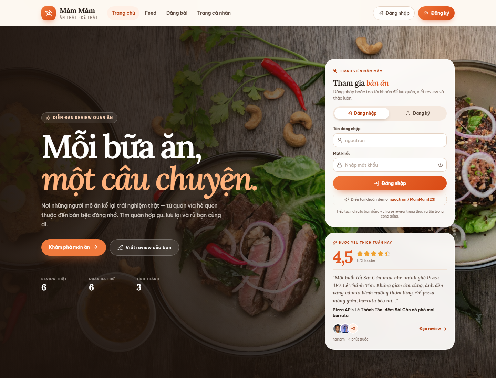

# Măm Măm Food Review — Fullstack

Dự án review quán ăn gồm **BackEnd Django REST Framework** và **FrontEnd React + Vite**, đã được liên kết hoàn chỉnh theo [GUIDE_LINK_FE_BE.md](./GUIDE_LINK_FE_BE.md).



## Tính năng đã hoàn thành

- **Xác thực bằng session Django**: đăng ký, đăng nhập, đăng xuất, tự khôi phục phiên khi tải lại trang, gửi kèm `X-CSRFToken` cho các request ghi dữ liệu.
- **2 form đăng nhập / đăng ký** hiển thị ở góc trên bên phải trang chủ (tab Đăng nhập · Đăng ký), tự chuyển thành thẻ tài khoản sau khi đăng nhập.
- **Feed**: lấy bài review thật từ API, tìm kiếm có debounce, lọc theo loại ẩm thực, sắp xếp, phân trang "Xem thêm", trạng thái tải/lỗi/rỗng.
- **Chi tiết bài review** (`/review/:id`): ảnh, video nhúng YouTube/TikTok/Vimeo, điểm 4 tiêu chí, thích, lưu quán, theo dõi tác giả, bình luận, form chấm điểm.
- **Đăng bài** (`/create`): chọn quán có sẵn hoặc thêm quán mới, chọn/tạo thẻ món ăn, tải nhiều ảnh, chọn ảnh bìa, nhập link video có xem trước, chấm điểm, xem trước bài viết.
- **Trang cá nhân** (`/profile`): hồ sơ thật, thống kê, tab bài đã đăng / quán đã lưu, chia sẻ hồ sơ.
- **Dữ liệu mẫu**: 8 người dùng, 6 nhà hàng, 6 bài review có ảnh/điểm/bình luận/lượt thích, 2 bài có video.

## Yêu cầu môi trường

- Python 3.12+ (đã kiểm thử với Python 3.14)
- Node.js 20+ và npm
- Windows / macOS / Linux

## Chạy BackEnd

```bash
cd BackEnd
py -m pip install -r requirements.txt      # hoặc: python -m pip install -r requirements.txt
py manage.py migrate
py manage.py tao_du_lieu_mau               # tạo dữ liệu mẫu (chạy lại nhiều lần vẫn an toàn)
py manage.py runserver
```

BackEnd chạy tại **http://127.0.0.1:8000**, trang quản trị **http://127.0.0.1:8000/admin/**.

## Chạy FrontEnd

```bash
cd FrontEnd
npm install
npm run dev
```

FrontEnd chạy tại **http://localhost:5173**. Vite đã cấu hình proxy `/api`, `/media`, `/static` sang BackEnd nên cookie session và CSRF hoạt động như cùng một origin.

> Nếu muốn gọi thẳng BackEnd (không qua proxy), tạo `FrontEnd/.env` với `VITE_API_BASE_URL=http://127.0.0.1:8000`.
> Khi đó cần thêm origin của FrontEnd vào `CSRF_TRUSTED_ORIGINS` trong `BackEnd/core/settings.py`.

## Tài khoản demo

| Tài khoản | Mật khẩu | Vai trò |
|---|---|---|
| `admin` | `admin123` | Quản trị viên |
| `ngoctran` | `MamMam123!` | Thành viên |
| `minhanh` | `MamMam123!` | Thành viên |
| `hainam` | `MamMam123!` | Thành viên |
| `maichi` | `MamMam123!` | Thành viên |

Gợi ý kiểm thử nhanh:

1. Mở trang chủ → góc trên bên phải → **Đăng nhập** bằng `ngoctran / MamMam123!`.
2. Vào **Feed**, thử tìm kiếm / lọc món Việt.
3. Mở một bài review, thích, bình luận, chấm điểm (nếu chưa chấm), xem video nhúng.
4. Vào **Đăng bài**, chọn quán, nhập nội dung, thêm link YouTube, tải ảnh → **Đăng review**.
5. Vào **Trang cá nhân** để xem bài đã đăng và quán đã lưu.

## API chính

| Phương thức | Endpoint | Mô tả |
|---|---|---|
| GET | `/api/csrf/` | Thiết lập cookie `csrftoken` |
| POST | `/api/dang-ky/` | Đăng ký và tự đăng nhập |
| POST | `/api/dang-nhap/` | Đăng nhập bằng session |
| POST | `/api/dang-xuat/` | Đăng xuất |
| GET, PATCH | `/api/ho-so/` | Xem / cập nhật hồ sơ hiện tại |
| GET/POST | `/api/bai-review/` | Danh sách (phân trang) / tạo bài |
| GET/PATCH/DELETE | `/api/bai-review/{id}/` | Chi tiết / sửa / xóa bài |
| POST | `/api/bai-review/{id}/thich/` | Bật/tắt lượt thích |
| GET/POST | `/api/binh-luan/` | Bình luận (`?bai_review=1`) |
| GET/POST | `/api/cham-diem/` | Chấm điểm (mỗi người một lượt/bài) |
| GET/POST | `/api/hinh-anh/` | Ảnh bài review (multipart) |
| GET/POST | `/api/nha-hang/` | Quán ăn (thành viên được thêm quán mới) |
| GET/POST | `/api/the-mon-an/` | Thẻ món ăn (thành viên được thêm thẻ) |
| GET/POST/DELETE | `/api/quan-yeu-thich/` | Quán đã lưu |
| GET/POST/DELETE | `/api/theo-doi/` | Theo dõi người dùng |

Tham số hữu ích cho danh sách: `search`, `ordering`, `page`, `page_size` (tối đa 100), `loai_am_thuc`, `nha_hang`, `nguoi_dung`, `trang_thai`.

## Cấu trúc chính

```
Project_Web_Fullstack/
├── BackEnd/
│   ├── core/                     # settings, urls, phân trang dùng chung
│   ├── reviews/
│   │   ├── models.py             # 10 bảng nghiệp vụ + video_url cho BaiReview
│   │   ├── serializers.py        # dữ liệu trả về giàu thông tin cho FE
│   │   ├── views.py              # CRUD, session auth, CSRF, thích, hồ sơ
│   │   ├── urls.py
│   │   └── management/commands/tao_du_lieu_mau.py
│   └── media/                    # ảnh người dùng + ảnh mẫu
├── FrontEnd/
│   └── src/
│       ├── api/                  # client.js (CSRF/session), auth, reviews, catalog
│       ├── context/              # AuthProvider (khôi phục phiên đăng nhập)
│       ├── components/
│       │   ├── Auth/             # AuthCard + LoginForm + RegisterForm
│       │   ├── Header/
│       │   ├── ReviewCard/
│       │   ├── StarPicker/
│       │   └── ProtectedRoute/
│       ├── pages/                # Home, Feed, ReviewDetail, CreatePost, Profile
│       └── utils/                # videoEmbed, format, adapters
└── README.md
```

## Ghi chú kỹ thuật

- **Session + CSRF**: `POST /api/dang-nhap/` tạo `sessionid`; `apiFetch` tự đọc cookie `csrftoken` và gửi header `X-CSRFToken` cho mọi request ghi dữ liệu. Không lưu token trong `localStorage`.
- **Video**: `src/utils/videoEmbed.js` nhận diện YouTube (`watch`, `youtu.be`, `shorts`, `live`, `embed`), TikTok và Vimeo, đổi sang URL nhúng iframe 16:9.
- **Ảnh**: ảnh mẫu được sao chép từ `FrontEnd/src/assets/img` sang `BackEnd/media/` khi chạy `tao_du_lieu_mau`; ảnh người dùng tải lên lưu tại `BackEnd/media/reviews/`.
- **Bài mới** mặc định ở trạng thái `cho_duyet` (chờ duyệt); tác giả và quản trị viên vẫn xem được. Quản trị viên có thể duyệt trong Django Admin.
- **Dữ liệu mẫu** có thể chạy lại nhiều lần: lệnh dùng `get_or_create` theo khóa nghiệp vụ.
