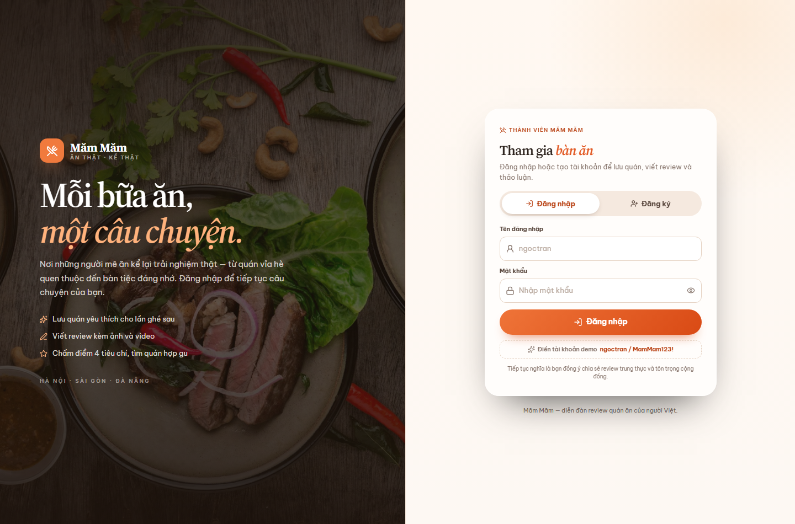
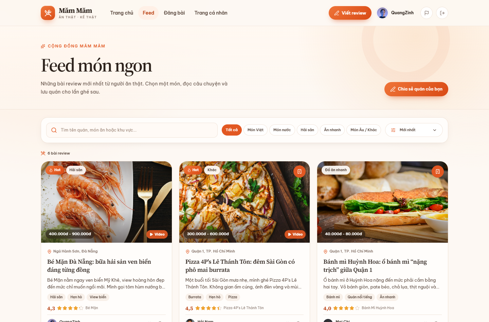
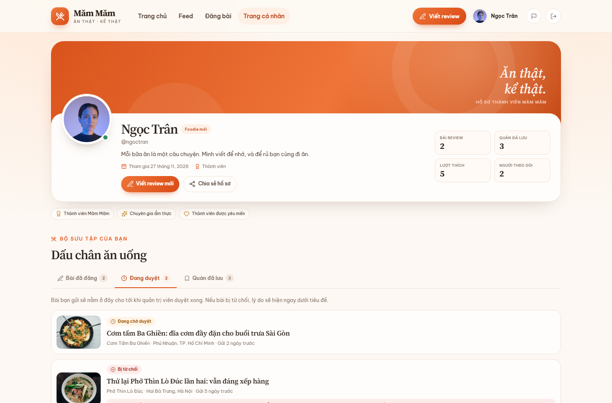
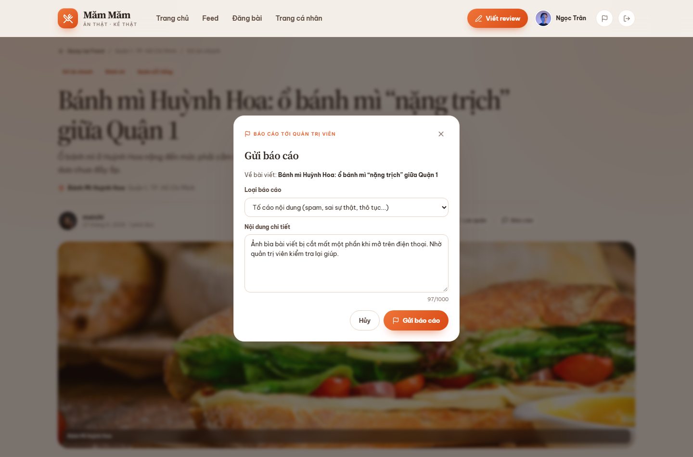
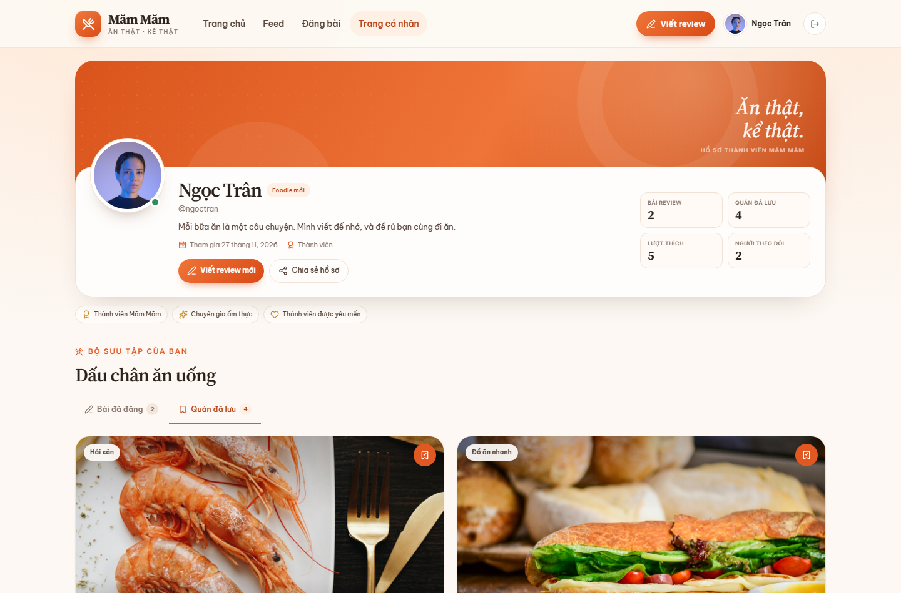

# Măm Măm Food Review — Fullstack

Dự án review quán ăn gồm **BackEnd Django REST Framework** và **FrontEnd React + Vite**, đã được liên kết hoàn chỉnh theo [GUIDE_LINK_FE_BE.md](./GUIDE_LINK_FE_BE.md).



## Tính năng đã hoàn thành

- **Xác thực bằng session Django**: trang đăng nhập / đăng ký riêng tại `/dang-nhap` và `/dang-ky`; khi mở web, FrontEnd gọi `GET /api/ho-so/` để kiểm tra phiên đã lưu và tự chuyển về trang đăng nhập nếu chưa có phiên (kèm `?next=` để quay lại đúng trang đang mở). Đăng xuất, gửi kèm `X-CSRFToken` cho các request ghi dữ liệu.
<<<<<<< HEAD
- **Quán yêu thích**: bảng `QuanYeuThich` (người dùng · nhà hàng · ngày lưu, mỗi quán lưu một lần) với API `/api/quan-yeu-thich/`. Người dùng lưu quán ở **trang chi tiết bài viết**; ở **Feed**, thẻ chỉ hiện nút khi quán đã lưu (bấm để bỏ lưu), thẻ chưa lưu không có nút. Danh sách hiện ở tab “Quán đã lưu” của trang cá nhân.
- **Feed**: lấy bài review thật từ API, **chỉ hiển thị bài đã được duyệt** (bài chờ duyệt / bị từ chối chỉ nằm ở trang cá nhân của tác giả), tìm kiếm có debounce, lọc theo loại ẩm thực, sắp xếp, phân trang "Xem thêm", trạng thái tải/lỗi/rỗng.
- **Chi tiết bài review** (`/review/:id`): ảnh, video nhúng YouTube/TikTok/Vimeo, điểm 4 tiêu chí, thích, lưu quán, theo dõi tác giả, bình luận, form chấm điểm, nút **Báo cáo**.
- **Báo cáo tới quản trị viên**: bảng `BaoCao` (tố cáo nội dung / báo lỗi giao diện / báo lỗi dữ liệu / khác, kèm trạng thái xử lý và phản hồi). Nút “Báo cáo” ở trang chi tiết (gắn với bài viết) và nút cờ trên header (báo lỗi chung); quản trị viên xử lý trong Django Admin.
=======
- **Quán yêu thích**: bảng `QuanYeuThich` (người dùng · nhà hàng · ngày lưu, mỗi quán lưu một lần) với API `/api/quan-yeu-thich/`; nút lưu / bỏ lưu quán ngay trên thẻ ở Feed và ở trang chi tiết, danh sách hiện ở tab “Quán đã lưu” của trang cá nhân.
- **Feed**: lấy bài review thật từ API, tìm kiếm có debounce, lọc theo loại ẩm thực, sắp xếp, phân trang "Xem thêm", trạng thái tải/lỗi/rỗng.
- **Chi tiết bài review** (`/review/:id`): ảnh, video nhúng YouTube/TikTok/Vimeo, điểm 4 tiêu chí, thích, lưu quán, theo dõi tác giả, bình luận, form chấm điểm.
>>>>>>> 10e11e78a0f876c04775151896a07e332623ca5d
- **Đăng bài** (`/create`): chọn quán có sẵn hoặc thêm quán mới, chọn/tạo thẻ món ăn, tải nhiều ảnh, chọn ảnh bìa, nhập link video có xem trước, chấm điểm, xem trước bài viết.
- **Kiểm duyệt bài viết**: bài mới ở trạng thái `cho_duyet`; quản trị viên **duyệt** hoặc **từ chối kèm lý do** (Django Admin hoặc API `duyet` / `tu_choi`). Tác giả theo dõi ở tab “Đang duyệt” của trang cá nhân: bài chờ duyệt và bài **Bị từ chối** kèm lý do của quản trị viên.
- **Trang cá nhân** (`/profile`): hồ sơ thật, thống kê, tab bài đã đăng / đang duyệt / quán đã lưu, chia sẻ hồ sơ.
- **Dữ liệu mẫu**: 5 người dùng, 6 nhà hàng, 8 bài review (6 đã đăng, 1 chờ duyệt, 1 bị từ chối) có ảnh/điểm/bình luận/lượt thích, 2 bài có video, 2 báo cáo mẫu.

## Yêu cầu môi trường

- Python 3.12+ (đã kiểm thử với Python 3.14)
- Node.js 20+ và npm
- Windows / macOS / Linux

## Chạy BackEnd

```bash
cd BackEnd
py -m pip install -r requirements.txt      # hoặc: python -m pip install -r requirements.txt
py manage.py migrate
py manage.py tao_du_lieu_mau               # tạo dữ liệu mẫu (chạy lại nhiều lần vẫn an toàn)
py manage.py runserver
```

BackEnd chạy tại **http://127.0.0.1:8000**, trang quản trị **http://127.0.0.1:8000/admin/**.

## Chạy FrontEnd

```bash
cd FrontEnd
npm install
npm run dev
```

FrontEnd chạy tại **http://localhost:5173**. Vite đã cấu hình proxy `/api`, `/media`, `/static` sang BackEnd nên cookie session và CSRF hoạt động như cùng một origin.

> Nếu muốn gọi thẳng BackEnd (không qua proxy), tạo `FrontEnd/.env` với `VITE_API_BASE_URL=http://127.0.0.1:8000`.
> Khi đó cần thêm origin của FrontEnd vào `CSRF_TRUSTED_ORIGINS` trong `BackEnd/core/settings.py`.

## Tài khoản demo

| Tài khoản | Mật khẩu | Vai trò |
|---|---|---|
| `admin` | `admin123` | Quản trị viên |
| `ngoctran` | `MamMam123!` | Thành viên |
| `minhanh` | `MamMam123!` | Thành viên |
| `hainam` | `MamMam123!` | Thành viên |
| `maichi` | `MamMam123!` | Thành viên |

Gợi ý kiểm thử nhanh:

1. Mở web → tự chuyển tới trang **Đăng nhập** (`/dang-nhap`) → đăng nhập bằng `ngoctran / MamMam123!` (hoặc bấm tab **Đăng ký** ở `/dang-ky` để tạo tài khoản mới).
<<<<<<< HEAD
2. Vào **Feed**: thẻ chưa lưu không có nút; mở một bài review → bấm **Lưu quán** → quay lại Feed, thẻ của quán đó hiện nút **bỏ lưu**.
3. Ở trang chi tiết, thử **Báo cáo** bài viết (chọn loại, mô tả ≥ 10 ký tự → gửi); nút cờ trên header để báo lỗi chung.
4. Vào **Trang cá nhân** → tab **Đang duyệt** để xem bài chờ duyệt và bài bị từ chối kèm lý do; tab **Quán đã lưu** để xem/bỏ lưu quán.
5. Vào **Đăng bài**, chọn quán, nhập nội dung, thêm link YouTube, tải ảnh → **Đăng review** (bài mới sẽ ở trạng thái chờ duyệt).
6. Duyệt / từ chối bài trong **Django Admin** (`/admin/` → Bài review → chọn bài → action “Duyệt…” hoặc “Từ chối…”, nhập ô *Lý do từ chối* trước khi từ chối).
7. Bấm **Đăng xuất** trên header → quay lại trang đăng nhập; thử mở lại `/feed` để thấy tự chuyển hướng về `/dang-nhap?next=/feed`.
=======
2. Vào **Feed**, thử tìm kiếm / lọc món Việt, và bấm nút dấu trang ở góc thẻ để **lưu / bỏ lưu quán**.
3. Mở một bài review, thích, bình luận, chấm điểm (nếu chưa chấm), xem video nhúng.
4. Vào **Đăng bài**, chọn quán, nhập nội dung, thêm link YouTube, tải ảnh → **Đăng review**.
5. Vào **Trang cá nhân** để xem bài đã đăng và tab **Quán đã lưu**.
6. Bấm **Đăng xuất** trên header → quay lại trang đăng nhập; thử mở lại `/feed` để thấy tự chuyển hướng về `/dang-nhap?next=/feed`.
>>>>>>> 10e11e78a0f876c04775151896a07e332623ca5d

## API chính

| Phương thức | Endpoint | Mô tả |
|---|---|---|
| GET | `/api/csrf/` | Thiết lập cookie `csrftoken` |
| POST | `/api/dang-ky/` | Đăng ký và tự đăng nhập |
| POST | `/api/dang-nhap/` | Đăng nhập bằng session |
| POST | `/api/dang-xuat/` | Đăng xuất |
| GET, PATCH | `/api/ho-so/` | Xem / cập nhật hồ sơ hiện tại |
| GET/POST | `/api/bai-review/` | Danh sách (phân trang) / tạo bài |
| GET/PATCH/DELETE | `/api/bai-review/{id}/` | Chi tiết / sửa / xóa bài |
| POST | `/api/bai-review/{id}/thich/` | Bật/tắt lượt thích |
| POST | `/api/bai-review/{id}/duyet/` | Duyệt bài (quản trị viên) |
| POST | `/api/bai-review/{id}/tu_choi/` | Từ chối bài kèm `ly_do_tu_choi` (quản trị viên) |
| GET/POST | `/api/binh-luan/` | Bình luận (`?bai_review=1`) |
| GET/POST | `/api/cham-diem/` | Chấm điểm (mỗi người một lượt/bài) |
| GET/POST | `/api/hinh-anh/` | Ảnh bài review (multipart) |
| GET/POST | `/api/nha-hang/` | Quán ăn (thành viên được thêm quán mới) |
| GET/POST | `/api/the-mon-an/` | Thẻ món ăn (thành viên được thêm thẻ) |
| GET/POST/DELETE | `/api/quan-yeu-thich/` | Quán đã lưu |
| GET/POST/DELETE | `/api/theo-doi/` | Theo dõi người dùng |
| GET/POST | `/api/bao-cao/` | Gửi báo cáo / xem báo cáo (admin thấy tất cả, thành viên thấy của mình) |
| PATCH/DELETE | `/api/bao-cao/{id}/` | Xử lý hoặc xóa báo cáo (quản trị viên) |

Tham số hữu ích cho danh sách: `search`, `ordering`, `page`, `page_size` (tối đa 100), `loai_am_thuc`, `nha_hang`, `nguoi_dung`, `trang_thai` (`cho_duyet` / `da_dang` / `bi_tu_choi` / `an`).

## Cấu trúc chính

```
Project_Web_Fullstack/
├── BackEnd/
│   ├── core/                     # settings, urls, phân trang dùng chung
│   ├── reviews/
│   │   ├── models.py             # 11 bảng nghiệp vụ (thêm BaoCao) + video_url, lý do từ chối
│   │   ├── serializers.py        # dữ liệu trả về giàu thông tin cho FE
│   │   ├── views.py              # CRUD, session auth, CSRF, thích, duyệt / từ chối, báo cáo
│   │   ├── urls.py
│   │   └── management/commands/tao_du_lieu_mau.py
│   └── media/                    # ảnh người dùng + ảnh mẫu
├── FrontEnd/
│   └── src/
│       ├── api/                  # client.js (CSRF/session), auth, reviews, catalog, reports
│       ├── context/              # AuthProvider (khôi phục phiên đăng nhập)
│       ├── components/
│       │   ├── Auth/             # AuthCard + LoginForm + RegisterForm
<<<<<<< HEAD
│       │   ├── Header/           # điều hướng + nút báo lỗi / tố cáo
│       │   ├── ReportModal/      # hộp thoại gửi báo cáo tới quản trị viên
│       │   ├── ReviewCard/       # thẻ bài viết + nút lưu / bỏ lưu quán
=======
│       │   ├── Header/
│       │   ├── ReviewCard/       # thẻ bài viết + nút lưu quán
>>>>>>> 10e11e78a0f876c04775151896a07e332623ca5d
│       │   ├── StarPicker/
│       │   └── ProtectedRoute/   # ProtectedRoute (bắt buộc đăng nhập) + GuestRoute
│       ├── pages/                # AuthPage, Home, Feed, ReviewDetail, CreatePost, Profile
│       └── utils/                # videoEmbed, format, adapters
└── README.md
```

## Ghi chú kỹ thuật

- **Session + CSRF**: `POST /api/dang-nhap/` tạo `sessionid`; `apiFetch` tự đọc cookie `csrftoken` và gửi header `X-CSRFToken` cho mọi request ghi dữ liệu. Không lưu token trong `localStorage`.
- **Video**: `src/utils/videoEmbed.js` nhận diện YouTube (`watch`, `youtu.be`, `shorts`, `live`, `embed`), TikTok và Vimeo, đổi sang URL nhúng iframe 16:9.
- **Ảnh**: ảnh mẫu được sao chép từ `FrontEnd/src/assets/img` sang `BackEnd/media/` khi chạy `tao_du_lieu_mau`; ảnh người dùng tải lên lưu tại `BackEnd/media/reviews/`.
- **Kiểm duyệt**: bài mới ở trạng thái `cho_duyet`; tác giả và quản trị viên vẫn xem được. Quản trị viên duyệt / từ chối trong Django Admin (action hàng loạt, nhập ô “Lý do từ chối” trước khi từ chối) hoặc qua `POST /api/bai-review/{id}/duyet/` và `/tu_choi/`. Bài bị từ chối chuyển sang `bi_tu_choi`, lý do lưu ở `BaiReview.ly_do_tu_choi` và hiển thị ở tab “Đang duyệt” + trang chi tiết.
- **Báo cáo**: mỗi người chỉ được có một báo cáo đang chờ xử lý cho cùng một bài viết (chặn trùng ở serializer); nội dung mô tả tối thiểu 10 ký tự.
- **Dữ liệu mẫu** có thể chạy lại nhiều lần: lệnh dùng `get_or_create` theo khóa nghiệp vụ.

## Giao diện

<<<<<<< HEAD





=======

>>>>>>> 10e11e78a0f876c04775151896a07e332623ca5d


